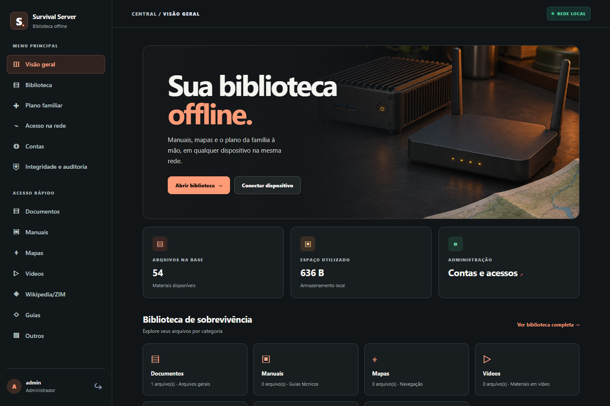
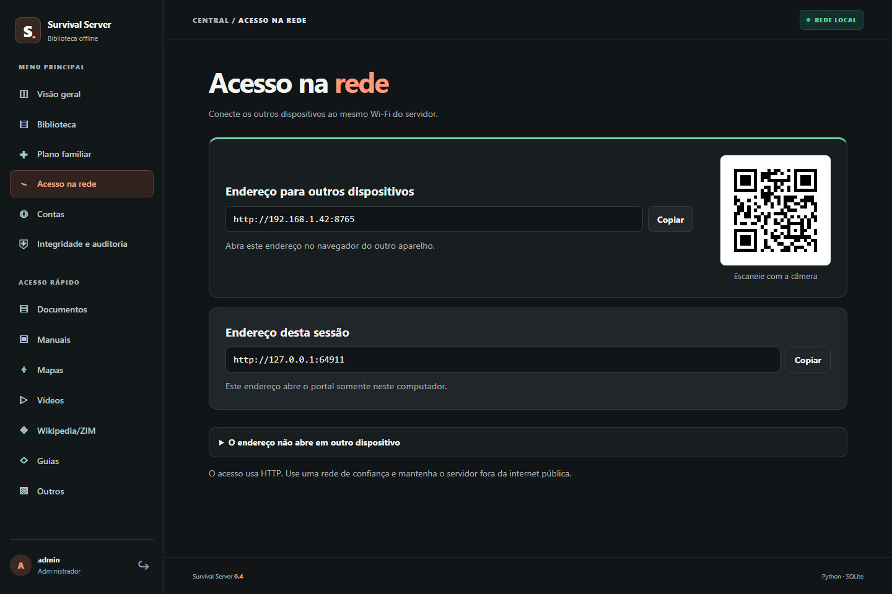
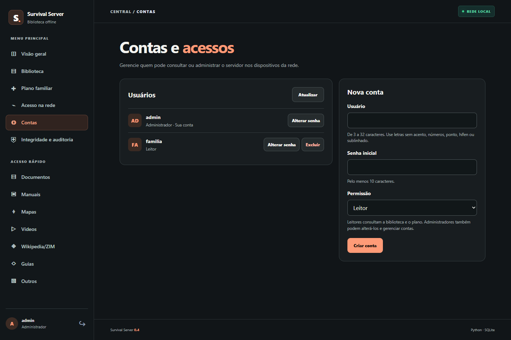
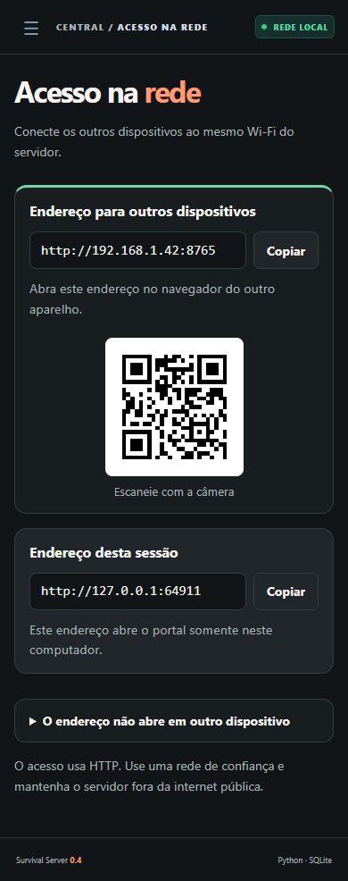
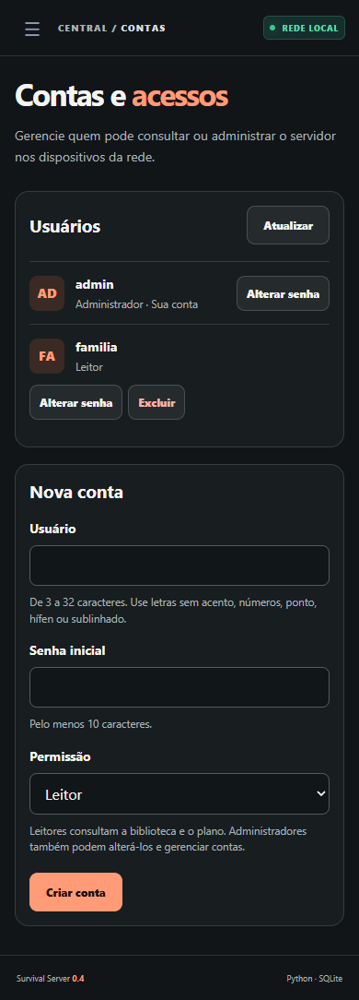

<div align="center">
  <p><strong>Biblioteca digital, plano familiar e ferramentas de recuperação para acessar informações essenciais sem internet.</strong></p>
  <p>
    
    
    
    
    
  </p>
</div>

<div align="center">
  <a href="screenshots/dashboard.png"></a>
  <br>
  <sub>Visão geral do portal</sub>
</div>

---

## 🖥️ Sobre

**Survival Server** é um servidor portátil para organizar e disponibilizar uma biblioteca de arquivos e um plano familiar de emergência em uma **rede local**. Computadores e celulares conectados à mesma rede podem acessar a interface pelo navegador, sem a necessidade de um serviço em nuvem.

O projeto foi pensado para funcionar em **Windows, Linux e Raspberry Pi**. Após a preparação do ambiente, o uso normal do servidor **não depende de conexão com a internet**: basta ter o equipamento ligado e a rede local funcionando.

> O acesso é feito por **HTTP na rede local**, sem criptografia de tráfego. Utilize apenas redes confiáveis e não exponha a porta do servidor à internet.

---

## ✨ Funcionalidades

- **Biblioteca offline:** armazenamento e organização de PDFs, imagens, vídeos, mapas, arquivos ZIP e ZIM.
- **Acesso pelo navegador:** interface disponível para computadores e dispositivos móveis conectados à mesma rede.
- **Compartilhamento de endereço:** IPv4 da rede com botão de cópia, seleção manual e QR gerado no próprio portal.
- **Controle de acesso:** login com perfis de **administrador** e **leitor**, com permissões distintas.
- **Gestão de contas pelo navegador:** administradores podem criar usuários, alterar senhas e remover contas. Trocas de senha e exclusões encerram as sessões afetadas.
- **Pesquisa no acervo:** busca por nome e descrição e, em formatos compatíveis, pelo conteúdo de arquivos de texto.
- **Navegação paginada:** listagem e busca da biblioteca com **50 arquivos por página**.
- **Plano familiar:** registro de contatos, pontos de encontro, rotas de evacuação, suprimentos e orientações de emergência.
- **Editor do plano:** edição multilinha pelo administrador, com tratamento de falhas parciais no envio de arquivos.
- **Integridade dos dados:** auditoria de arquivos usando **SHA-256** e diagnóstico de integridade do banco **SQLite**.
- **Histórico administrativo:** registro local de logins, operações de contas, uploads, exclusões de arquivos e alterações no plano.
- **Manifesto JSON:** exportação do catálogo com informações como tamanho, categoria e hash dos arquivos.
- **Backup e restauração:** exportação em ZIP, verificação de integridade e restauração validada.
- **Importação de arquivos grandes:** suporte à importação de ZIM pela linha de comando.

---

## 📸 Capturas da interface

<table>
  <tr>
    <td width="50%" align="center">
      <a href="screenshots/acesso-rede.png"></a>
      <br><sub>Acesso na rede · desktop</sub>
    </td>
    <td width="50%" align="center">
      <a href="screenshots/contas.png"></a>
      <br><sub>Gestão de contas · desktop</sub>
    </td>
  </tr>
</table>

<table>
  <tr>
    <td width="50%" align="center">
      <a href="screenshots/mobile/acesso-rede.png"></a>
      <br><sub>Acesso na rede · celular</sub>
    </td>
    <td width="50%" align="center">
      <a href="screenshots/mobile/contas.png"></a>
      <br><sub>Gestão de contas · celular</sub>
    </td>
  </tr>
</table>

As capturas foram feitas no Edge com o portal em execução, contas de teste e endereço de rede ilustrativo no QR.

---

## 🧱 Tecnologias

<div align="center">
  
  
  
  
  
  
</div>

---

## 🗂️ Estrutura do projeto

```text
SurvivalServer/
├── .github/
│   └── workflows/
│       └── python-ci-survivalserver.yml
├── docs/                          # Documentação do projeto
├── screenshots/                   # Capturas de desktop e celular
├── static/                        # Portal e recursos empacotados
├── tests/                         # Testes automatizados
├── server.py                      # Servidor e comandos administrativos
├── iniciar_windows.bat            # Inicialização no Windows
├── iniciar_linux.sh               # Inicialização no Linux
└── README.md
```

> A pasta `dados_survival` guarda os dados da instalação. Preserve-a ao atualizar ou migrar o servidor.

---

## 🚀 Como começar

### 1. Requisitos

- **Python 3.10 ou superior** instalado no equipamento que será o servidor.
- Um computador com Windows ou Linux, ou um Raspberry Pi compatível.
- Uma rede local ou Wi-Fi à qual os dispositivos clientes possam se conectar.

### 2. Inicie o servidor

Baixe ou clone o repositório e abra a pasta do projeto.

**Windows:** execute `iniciar_windows.bat`.

**Linux / Raspberry Pi:**

```bash
./iniciar_linux.sh
```

Na configuração inicial, defina a senha do **administrador** e, se desejar, crie a conta **`familia`** para acesso de leitura.

Também é possível utilizar os comandos diretamente:

```bash
python server.py init
python server.py run --lan
```

> O comando `init` é para a primeira configuração. Nas execuções seguintes, inicie com `python server.py run --lan`. Em alguns sistemas, pode ser necessário usar `python3` no lugar de `python`.

### 3. Acesse pelo navegador

No próprio equipamento servidor:

```text
http://127.0.0.1:8765
```

Para conectar outro dispositivo, faça login no servidor, abra **Acesso na rede** e copie o endereço ou escaneie o QR pela câmera do celular. Conecte os aparelhos ao mesmo Wi-Fi. Também é possível digitar o endereço mostrado no terminal do servidor.

```text
http://IP_DO_COMPUTADOR:8765
```

A porta padrão é **8765**. Se o servidor listar mais de um IPv4, confira o endereço do adaptador Wi-Fi ou Ethernet usando `ipconfig` no Windows ou `ip -4 addr` no Linux. A aba **Acesso na rede** inclui passos de diagnóstico para firewall e redes de convidados.

### 4. Gerencie o acesso da família

Entre como administrador e abra **Contas**. Crie contas de leitura para quem só precisa consultar a biblioteca e o plano. A tela permite alterar a senha ou excluir uma conta, encerrando as sessões dela em outros dispositivos. Ao alterar a própria senha, entre novamente com a nova senha.

As decisões sobre conectividade, permissões, acessibilidade e os próximos passos para HTTPS e mDNS estão na [pesquisa de arquitetura](docs/ARQUITETURA.md#pesquisa-aplicada-à-versão-04).

---

## 📚 Biblioteca e plano familiar

Após fazer login, utilize a biblioteca para enviar, organizar, pesquisar e baixar arquivos. O administrador pode gerenciar o acervo e editar o **Plano familiar**; o usuário leitor pode consultar as informações disponíveis para seu perfil.

O plano permite centralizar orientações como **contatos essenciais, pontos de encontro, evacuação e suprimentos**. A área **Integridade e auditoria** fica disponível somente para administradores.

**Limites importantes:**

- Upload pelo navegador: **512 MB** por arquivo, por padrão.
- Arquivos ZIM maiores: importe pelo terminal usando `import-file`.
- Pesquisa em conteúdo: arquivos **TXT, MD, CSV, JSON e LOG**, até **100 KB** de texto por arquivo.
- PDFs e ZIM podem ser armazenados, mas **não têm seu conteúdo interno indexado** pela busca.
- Para consultar o conteúdo de um ZIM, execute o **`kiwix-serve` separadamente**.

### Comandos úteis

```bash
# Verificar estado do banco e do armazenamento
python server.py doctor

# Conferir os hashes dos arquivos
python server.py verify

# Criar um backup ZIP
python server.py backup backup-survival.zip

# Importar um arquivo ZIM grande
python server.py import-file /caminho/arquivo.zim --category "Wikipedia/ZIM"
```

---

## 💾 Backup, verificação e restauração

O comando de backup gera um **ZIP com uma cópia consistente do catálogo e dos arquivos**. Antes de publicar o arquivo de destino, o processo verifica os hashes SHA-256 dos objetos incluídos.

**Criar um backup:**

```bash
python server.py backup backup-survival.zip
```

Salve o ZIP **fora de `dados_survival`**, preferencialmente em uma unidade externa. A criação do backup permite consultas enquanto ocorre; operações de escrita podem ter de aguardar ou ser repetidas.

**Restaurar um backup:**

1. **Pare o servidor**, se ele estiver em execução.
2. Confirme que o arquivo ZIP veio de uma origem confiável.
3. Execute:

```bash
python server.py restore /caminho/backup-survival.zip --yes
```

A restauração valida o catálogo e o conteúdo **antes de substituir os dados**. Se já houver uma pasta de dados, a versão anterior é preservada com o sufixo `.anterior_...`. O servidor recusa a operação caso esteja aberto.

> **Atenção:** o backup ZIP padrão **não é criptografado**. O limite aceito pelo projeto é de **200 GiB de conteúdo descompactado**, incluindo o banco de dados.

### Proteger o backup com Backup Guardian

Para armazenar o ZIP com proteção por senha, utilize o projeto **Backup Guardian** e seu comando `seal`:

```bash
python backup_guardian.py seal /caminho/backup-survival.zip /caminho/pendrive/backup-survival.zip.bgc
```

Antes de restaurar o servidor, recupere o ZIP com `unseal`, pare o Survival Server e execute o comando `restore` indicado acima. O Backup Guardian utiliza **AES-256-GCM** para o arquivo protegido; essa criptografia **não é nativa do Survival Server**.

---

## 🔄 Atualização para a versão 0.4

Para atualizar instalações das versões **0.1 a 0.3**:

1. Pare a versão anterior com `Ctrl+C`.
2. Faça uma cópia da pasta inteira `dados_survival` e gere um ZIP com `python server.py backup backup-versao-anterior.zip`.
3. Extraia a versão 0.4 em outra pasta e copie `dados_survival` para a nova instalação.
4. Inicie o servidor com `python server.py run --lan`; as migrações necessárias são aplicadas aos dados existentes.
5. Verifique o acesso, os arquivos e o plano familiar. Depois execute `python server.py doctor`.

Conserve o backup e a instalação antiga até concluir as verificações.

### Melhorias da v0.3

- Paginação de arquivos e manifesto completo do acervo.
- Editor multilinha do plano familiar e reenvio apenas de uploads pendentes em caso de falha parcial.
- Verificação SHA-256 na criação do backup e validação antes da restauração.
- Melhorias na política de carregamento dos recursos locais da interface.
- Recuperação de inicialização interrompida antes da criação do primeiro usuário.

---

## 🛡️ Segurança e limitações

- O servidor utiliza **HTTP local**: login e conteúdos **não são criptografados durante o transporte**.
- Use redes **WPA2/WPA3 confiáveis**. **Não faça encaminhamento da porta 8765 para a internet** nem utilize redes Wi-Fi públicas.
- O projeto **não oferece VPN, sincronização automática ou criptografia nativa dos arquivos armazenados**.
- Não coloque documentos secretos ou dados bancários sensíveis no plano familiar. Para informações privadas, prefira um cofre criptografado, como o **Arca Offline**.
- Backups ZIP sem proteção devem ser tratados como arquivos sensíveis. Para criptografá-los, use o Backup Guardian.
- O acesso depende de energia elétrica, armazenamento e rede local funcionando. Mantenha cópias físicas de informações críticas.

---

## 🧪 Testes e qualidade

Execute os testes automatizados na raiz do projeto:

```bash
python -m unittest discover -s tests -p 'test_*.py' -v
```

O workflow `python-ci-survivalserver.yml` verifica a sintaxe e executa os testes em **Windows e Linux**, com **Python 3.10 e 3.12**.

### Teste de interface (opcional)

O arquivo `tests/test_browser_smoke.py` usa **Playwright** para verificar fluxos de navegação em desktop e celular. Com o Microsoft Edge instalado, execute:

```bash
python tests/test_browser_smoke.py --channel msedge
```

Para testar também pelo IPv4 do host e gerar as capturas do README, execute:

```bash
python tests/test_browser_smoke.py --channel msedge --lan --screenshots screenshots
```

O teste usa dados temporários e uma resolução de celular emulada. Para validar a rede local de destino, abra o portal em um celular físico enquanto o roteador estiver sem acesso à internet.

O gerador de QR, [qrcode-generator 2.0.4](https://github.com/kazuhikoarase/qrcode-generator/releases/tag/js2.0.4), é distribuído com sua [licença MIT](static/vendor/qrcode-LICENSE.txt). O visual do painel foi gerado com ImageGen e é servido [como recurso local](static/images/network-hero.webp).

---

<div align="center">
  <strong>Survival Server</strong><br />
  <sub>Informação acessível quando a conexão com a internet não está disponível.</sub>
</div>
